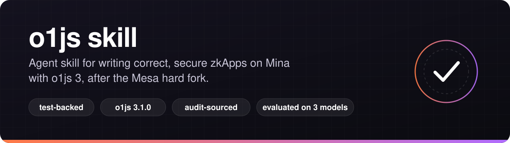

<p align="center">
  
</p>

<p align="center">
  <a href="https://github.com/izzetemredemir/o1js-skills/actions/workflows/test.yml"></a>
  
  
  
  <a href="LICENSE"></a>
</p>

<p align="center">
  <a href="#install">Install</a> ·
  <a href="#what-it-covers">What it covers</a> ·
  <a href="#does-it-help">Does it help?</a> ·
  <a href="#backed-by-tests">Backed by tests</a> ·
  <a href="CONTRIBUTING.md">Contributing</a>
</p>

An agent skill that teaches AI coding assistants (Claude Code, Codex, Cursor and others that read `SKILL.md`) to write correct, secure **o1js 3** code for **Mina** zkApps after the **Mesa** hard fork.

> [!IMPORTANT]
> In our evaluation, Claude Sonnet without the skill wrote a token that compiled and passed its own tests, and a stranger then minted 1,000,000 of it. With the skill, the same attack was rejected. [Details](eval/README.md)

## Install

Any agent that supports Agent Skills, via the [skills CLI](https://www.skills.sh/):

```bash
npx skills add izzetemredemir/o1js-skills
```

<details>
<summary>Claude Code plugin, or manual install</summary>

Claude Code plugin:

```
/plugin marketplace add izzetemredemir/o1js-skills
/plugin install o1js-skills
```

Manual (Claude Code, personal skill):

```bash
git clone https://github.com/izzetemredemir/o1js-skills
mkdir -p ~/.claude/skills
ln -s "$PWD/o1js-skills/skills/o1js" ~/.claude/skills/o1js
```

For a single project, link it into that project's `.claude/skills/` instead. Other tools: point them at `skills/o1js/SKILL.md`. The references and examples are plain markdown and TypeScript.

</details>

Then just ask for o1js work: "write a token where only the admin can mint", "upgrade my pre-Mesa zkApp on mainnet", "review this contract".

## Why

o1js 3.0 and 3.1 shipped in August and September 2026, alongside the Mesa hard fork (mainnet 2026-09-03). Most o1js code that models learned from was written for 0.x–2.x. So assistants confidently produce:
- removed APIs;
- `Mina.Network(url)` calls that sign for devnet when you meant mainnet;
- "upgrades" that silently reset permissions;
- tokens anyone can mint.

## What it covers

| | |
|---|---|
| **[SKILL.md](skills/o1js/SKILL.md)** | Defaults, the outdated patterns models write most often, core patterns, a 13-point security checklist, agent guardrails |
| **[migration](skills/o1js/references/migration.md)** | Every app-facing API change from 0.18 to 3.1, by area |
| **[mesa](skills/o1js/references/mesa.md)** | What Mesa changed, how to upgrade a pre-Mesa contract, known documentation bugs |
| **[security](skills/o1js/references/security.md)** | 20 pitfall classes with wrong/right code, drawn from public audits and o1js-scan |
| **[contracts](skills/o1js/references/contracts.md) · [provable code](skills/o1js/references/provable-code.md) · [transactions](skills/o1js/references/transactions.md)** | State, preconditions, permissions, witnesses, conditionals, fees, the 16-segment limit, networks |
| **[zkprogram](skills/o1js/references/zkprogram.md) · [actions & off-chain state](skills/o1js/references/actions-and-offchain-state.md) · [tokens](skills/o1js/references/tokens.md)** | Recursion, reducers, `BatchReducer`, `OffchainState`, custom tokens |
| **[frontend](skills/o1js/references/frontend.md) · [testing](skills/o1js/references/testing.md) · [errors](skills/o1js/references/errors.md)** | Web Workers and wallets, project setup, error messages and their causes |
| **[examples](skills/o1js/examples/)** | Tested contracts the agent can read and copy |

## Does it help?

[eval/](eval/) gives Claude Opus, Sonnet and Haiku the same tasks with and without the skill, then grades the results by compiling them, running the tests and attacking the contracts.

| Task | Without the skill | With the skill |
|---|---|---|
| Token (Sonnet) | Compiles, passes its own tests, **a stranger mints 1,000,000** | `access: proof()`; the attack fails |
| Token (Haiku) | 6 compile errors; the contract key can mint | Compiles, tests pass, attack rejected |
| Mainnet upgrade (Haiku) | **Signs for devnet**; would be rejected on mainnet | Correct network, signed key update, asks before sending |
| Mainnet upgrade (Sonnet, Haiku) | Refuse to upgrade locked contracts that Mesa allows | Handle Mesa's permission fallback correctly |
| All tasks (Opus) | Mostly right; one compile error, one factual error | First-try compile, more attack tests |

One run per cell, so treat this as a demonstration rather than a benchmark. Method and outputs: [eval/README.md](eval/README.md).

## Backed by tests

The skill ships with [`skills/o1js/examples/`](skills/o1js/examples/), a small o1js 3.1.0 project whose tests reproduce what the skill says. Statements marked **[T]** in the references are backed by these tests; the few that aren't (browser code, some audit findings) are labelled as such.

- **API facts:** removed exports, renamed methods, the default network id and return shapes, pinned by runtime tests and compile-time `@ts-expect-error` checks.
- **Behaviour:** Mesa limits (16 segments, 32 state fields), the verification-key upgrade path, and the fact that `deploy()` resets permissions.
- **Attacks:**
  - a token with `access: none` minted by a stranger;
  - a token with `access: proofOrSignature` minted by its key holder;
  - flash mints and locked holder accounts;
  - and the hardened token rejecting all of them.
- **Pitfalls:** JS `if` on a `Bool`, unasserted `equals()`, read-after-write, `toBoolean()` in circuits, Poseidon padding collisions, `Provable.if` evaluating both branches, reducer limits, and `OffchainState` silently dropping a stale transfer.

```bash
npm install
npm test             # link check + type check + all tests without proofs (~15 s)
npm run test:proofs  # the same tests with real proofs (several minutes)
```

CI runs the fast suite on every push. Once a week it also runs the proving suite, and the whole suite against the newest o1js, so a release that breaks a claim shows up as a red build.

## Found along the way

Writing tests for every claim turned up problems upstream:
- an o1js bug in repeated range preconditions;
- `BatchReducer`'s default settings failing to prove;
- several official docs pages with code that is wrong for o1js 3.1.

They are listed in [references/mesa.md](skills/o1js/references/mesa.md#known-documentation-bugs) and [references/security.md](skills/o1js/references/security.md).

## Sources

- [o1js](https://github.com/o1-labs/o1js) source and CHANGELOG (3.1.0)
- [docs.o1labs.org](https://docs.o1labs.org) and [docs.minaprotocol.com](https://docs.minaprotocol.com)
- [o1js-scan](https://github.com/auditinfra-io/o1js-scan) rules
- Public audits: [zkSecurity](https://reports.zksecurity.xyz) (Mina treasury, Zeko) and [Veridise](https://veridise.com) (o1js, fungible token standard, Lumina, Silvana NFT, FROST multisig)

Where these sources disagree with o1js 3.1's behaviour, the skill follows the tests and lists the discrepancy.

This is a community project, not affiliated with o1Labs or the Mina Foundation.

## Contributing

Corrections, new pitfalls and test cases are welcome. See [CONTRIBUTING.md](CONTRIBUTING.md); the short version is: no claim without a test.

## License

[MIT](LICENSE)
